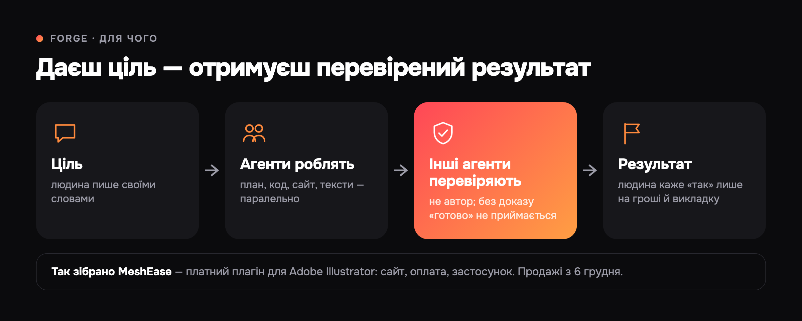
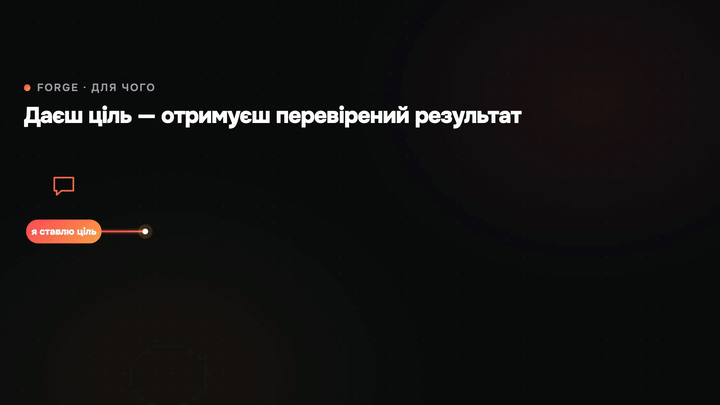
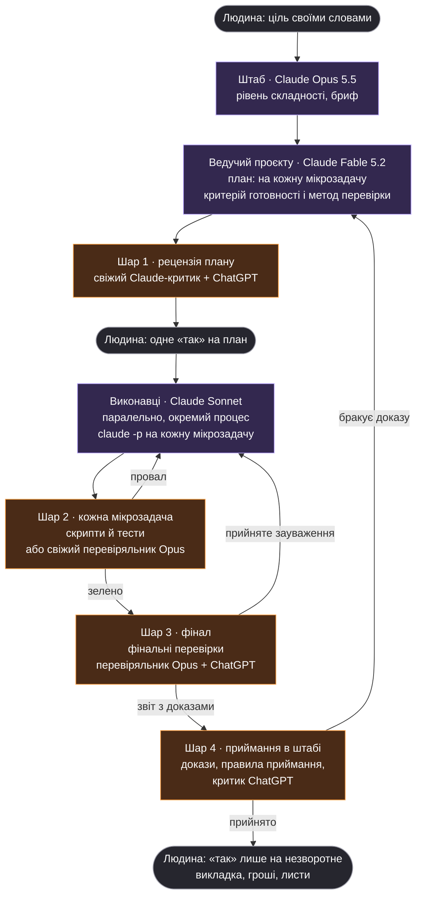

# Forge — харнес для команди AI-агентів у Claude Code

[](https://github.com/scrvex/forge-harness/actions/workflows/tests.yml) — 498 тестів проганяються на GitHub при кожній зміні

**Автор:** Демид Яцкін · Telegram [@scrvex](https://t.me/scrvex) · demidyatskin@gmail.com

| | |
|---|---|
| 🎞 Презентація, 3 хв | [слайди онлайн](https://claude.ai/artifact/ViWBVwNwknhzJPxPpd9V4k) · [PDF у цьому репозиторії](presentation.pdf) |
| 🎬 Ролик-кейс, 75 с | [дивитися](docs/media/mono_case.mp4) — зібрала моушн-студія, один із підпроєктів ([як](#приклад-підпроєкту--моушн-студія)) |
| 🛒 Продукт, зроблений цією системою | [meshease.io](https://meshease.io) — плагін для Adobe Illustrator, старт продажів 6 грудня |
| ⚙️ Як влаштована система | ця сторінка ↓ |
| 💻 Код системи | папка [`00_FORGE/`](00_FORGE) · 498 тестів: `python3 -m unittest discover -s 00_FORGE/tests` |



Forge — мій власний харнес усього процесу роботи з AI-агентами: від постановки задачі до перевіреного результату.
Він працює поверх Claude Code як плагін і як шар правил над кількома паралельними сесіями.

> Тут і опис архітектури, і код самої системи: хуки, ворота перевірок, охоронець, інструменти, навички, евали й тести.
> Робочих даних проєктів, журналів, ключів і коду продукту MeshEase тут немає.
> Розробка Forge іде з 17.09.2026 у приватному репозиторії (83 коміти до 22.11); тут — його публічна версія.

## Кейс у п’яти рядках

| | |
|---|---|
| **Задача** | Випустити платний продукт удвох: ядро плагіна пише розробниця, яка знає нішу зсередини, тож продукт вирішує справжній біль покупців; сервер ліцензій, оплата, сайт, застосунок, тести й маркетинг — на мені. Ми обоє й AI-агенти працюємо в одному стеку на спільних даних, тому задачі не губляться між людьми й сервісами |
| **Моя роль** | Вирішую, що важливо клієнту й бізнесу; ставлю цілі, приймаю план, перевіряю доказами, кажу «так» на все, що йде до людей |
| **Що робили агенти** | Писали код і тести, перевіряли одне одного, готували викладки з відкатом, досліджували ринок |
| **Результат** | ≈2 місяці — весь шлях покупця від сайту до оновлень, без найму команди; продажі з 6 грудня 2026 |
| **Чим перевірено** | 1460 автотестів сервера перед кожною викладкою, 116 перевірок живого продукту після неї, сторож щогодини; тут — 498 тестів харнесу в CI |

## Що це дало — і чому це важіль росту

**Чому без ШІ цей продукт не стартував би.** Основний сценарій фінмоделі з нинішнім планом маркетингу виходить на
близько 128 платних покупців. Це не межа ринку: більше дасть сильніший маркетинг. Але стартуємо саме з цим планом,
тому окупність на старті вирішує ціна команди. Порівнюю з двома варіантами найму, не лише з повним штатом:

| | Витрати на місяць | Скільки платних треба, щоб окупитися |
|---|---|---|
| Команда з 6 людей (бекенд, тести, DevOps, сайт, маркетинг, підтримка × $900, медіана junior) | ≈$5 555 (зарплати + $155 інших витрат) | **≈780** — у 6 разів більше за основний прогноз |
| Один розробник (middle × $2 500: код, сайт, сервер; маркетинг і підтримка — на мені) | ≈$2 655 | **≈370** — майже втричі більше за прогноз |
| AI-команда (усі постійні витрати, з них частка продукту в Claude і ChatGPT — $182) | **$337** | **48** |

48 — це $337 ÷ $7,11: стільки лишається з підписки $10 після ПДВ, комісії Paddle, повернень і податку. Витрати майже не
ростуть разом із покупцями, тож кожен платний понад 48-й — ще +$7,11 на місяць. Медіани зарплат — опитування DOU
листопада–грудня 2025 ([Forbes Ukraine, 12.01.2026](https://forbes.ua/news/mediana-zarplat-it-rozrobnikiv-zrosla-do-3450-khto-z-ukrainskikh-aytivtsiv-zaroblyae-naybilshe-doslidzhennya-dou-12012026-35431)).
Що не враховано: мій час — у жодному варіанті, а з ШІ його йде найбільше (я ставлю задачі й перевіряю). Це витрати
етапу збирання й перших місяців: після запуску команду можна було б зменшити, а підписки на ШІ лишаються. Кажуть, що ШІ
замінить людей; тут він нікого не замінив — навіть один найманий розробник на цьому прогнозі не окупився б.

**Де саме ШІ дає користь бізнесу:**

| Біль | Що зробив | Результат |
|---|---|---|
| Підтримка й продажі живуть у платних сервісах: Zendesk — від $55 за оператора на місяць, відповідь ШІ в Intercom — $0,99 за кожну | свій розбір листів: ШІ лише обирає одну з 8 затверджених відповідей (3 мови), 12 типів листів (гроші, скарги, юридичне) — завжди людині; своя CRM замість платної, щовечора о 21:00 — зведення, що відповіли й що передали людині | **$0 за лист** у межах безкоштовного ліміту (≈220 листів на день); в Intercom при 100 листах на день і половині закритих ШІ — ≈$1 500 на місяць (оцінка) |
| Відгук клієнта стає задачею в черзі, зміна виходить через тижні | 19.11 тестувальник: «обрав помісячну, а після пробного вона стала річною» — клієнт заплатив би $100 замість $10 | **2 дні** до виправлення, ще до старту продажів; пробний тепер з першої установки, а куплені до встановлення дні не згорають |
| Невідомо, чи заплатять за продукт, поки в нього не вкладено місяці | до запуску продав бету прогрітій аудиторії — Patreon MeshEase ($10 за 60 днів доступу) | **13 продажів бети** за 30 днів; 17 з 71 учасника (24 %) платять щомісячну підписку; ≈$127 до комісій, ≈$100 чистими — ≈30 % постійних витрат (знімок 09.11) |
| Гіпотезу перевіряють, коли на неї вже витрачено місяць | 15.11 чотири агенти перевірили 4 ринкові гіпотези (~190 джерел), окремий агент звірив посилання; прототип сторінки гайда — за день, критик розібрав його до розробки | **1 з 4** гіпотез відкинута до витрат (день і менше $2, ≈3 % тижневого ліміту підписки, оцінка); **9 проблем** знайдено на макеті, а не в 5 готових гайдах усіма мовами сайту |
| Рішення про ринок спираються на джерела, які ніхто не перевіряв | 22 дослідження агентами (ринок, партнери, канали); окремий агент відкриває кожне 3–5-те посилання й звіряє цифри | у вибірці **14 з 15** посилань підтвердились, решту виправлено до рішень |
| Бюджет на рекламу закладають наперед, а що канал не окупається, видно, коли гроші вже витрачено | фінмодель рахує, скільки приносить і скільки коштує клієнт; у кожної суми поріг і стоп-правило до старту | клієнт приносить **$177**, а коштує **$37** (прогноз); реклама — лише тест: стоп, якщо після $50 клік дорожчий за $0,54 |
| Бухгалтерія ФОП: помилка — це штраф | виписка monobank по API (лише рахунки ФОП, токен не записується на диск — це перевіряють тести), податки рахуються двічі незалежно й мають зійтися | ≈10 хв мого часу на квартал, бухгалтер не потрібен |

Ціни ринку: [Zendesk](https://www.zendesk.com/in/pricing/sales/), [Intercom Fin](https://intercom.com/help/en/articles/8205718-fin-resolutions);
зарплати — опитування DOU, зима 2025/26. Основні продажі через Paddle стартують 6 грудня; до того дохід дає лише Patreon (рядок вище), у фінмоделі він не врахований.

**Юніт-економіка MeshEase (прогноз фінмоделі v6, продажі стартують 06.12.2026).** Платний користувач залишає за весь час
підписки LTV ≈ $177 — після ПДВ, комісії Paddle, повернень і податку (місячний план ≈ $126, річний ≈ $228). Залучити
його коштує ≈ $37 грошима і 6,5 години власного часу; з годиною по $10 — ≈ $101. LTV/CAC ≈ 4,8 грошима і 1,7 з часом.
Основний платний канал — афіліат-програма: автори уроків отримують код −20 % для глядачів і 20 % комісії, платимо лише
після продажу (≈ $22 за платного, LTV/CAC ≈ 8). Реклама — тільки перевірка гіпотез: до $200 на місяць, стеля $600 за
3 місяці, у кожного каналу поріг і стоп-правило до старту (за відкритими цінами кліку платний із реклами коштував би
≈ $490). Модель рахує код з одного файлу конфігурації; відтік, конверсії, ціна години й частка AI на контент — припущення
до перших продажів.

**Порівняння з ринком** (дослідження 23.11, окремий агент звірив посилання): середній CAC софту для дизайну —
$274 для приватних покупців і $658 для малого бізнесу, разом з органікою ([First Page Sage](https://firstpagesage.com/seo-blog/average-cac-for-saas-businesses-by-industry-and-customer-type-fc/), 04.11.2026).
Мої $37 у 7 разів нижчі, бо в плані немає платної реклами: це ціль для контенту й авторів, а не факт. Якщо органіка не
спрацює, CAC ближчий до $100–150, і LTV/CAC падає до 1,2–1,8 — тому реклама лише тестом. Окупність 5 місяців — у межах
«добре» для споживчих продуктів (до 6 місяців, опитування 16 експертів, [Lenny’s Newsletter](https://www.lennysnewsletter.com/p/payback-period)).
Комісія афіліатам у ніші — 30 % (Envato, AEJuice); мої 20 % плюс знижка глядачам — ризик, що автори не підуть.

**Гіпотези до 6 грудня** (що перевіряю першим; без прогнозів виручки, рішення ще не прийняті):
- скільки візитів стають пробними: ціль 8 % (ринок 4,5–7,1 %, ChartMogul і First Page Sage); нижче 5,4 % — переробляю перший екран;
- скільки пробних купують: у моделі обережні 3,15 % (ринок від 2,1 % до 17,4 %); міряю з першого тижня продажів;
- що дасть перших платних дешевше за рекламу: каталог Adobe Exchange і партнери-викладачі з кодами;
- чи витримає продукт вищу ціну: тест $15 на місяць / $129 на рік проти $10 / $100 після перших платних.

Що роблю при кожному результаті, записано до старту, щоб потім не підганяти цифри.

## Що подивитись за 5 хвилин

1. [`examples/order-card.md`](examples/order-card.md) — атом системи: вимога людини → картка з критерієм готовності й методом перевірки.
2. [`00_FORGE/skills/forge-done/SKILL.md`](00_FORGE/skills/forge-done/SKILL.md) — як закривається задача: лише з доказом (файл, тест або скриншот), інакше «готово» не приймається.
3. [`00_FORGE/evals/README.md`](00_FORGE/evals/README.md) — сценарії поведінки: кожен проганяється з Forge і без нього, рахується різниця.
4. `python3 -m unittest discover -s 00_FORGE/tests` — 498 тестів за ~2 хв, без сторонніх пакетів.

## Приклад підпроєкту — моушн-студія

[](docs/media/mono_case.mp4)

[Повний ролик зі звуком, 75 с (MP4)](docs/media/mono_case.mp4)

Ролик зібрала моушн-студія — один із підпроєктів, що робить відео кодом із бібліотек, без ручного монтажу.
- Ролик 75 с, 1920×1080, 60 к/с: React-сцени на Remotion 4.0.542, одне полотно, камера по ключах, темп задає «карта часу».
- Усередині — окреме 25-секундне промо MeshEase, «ролик у ролику»: головна з промо-фільмом, інструменти, вхід, акаунт, оплата (тестовий режим Paddle), завантаження.
- Сторінки живого сайту meshease.io записано покадрово через Playwright 1.45 у Chromium: час сторінки, анімації й відео крокують рівно на 1/60 с.
- Музика — «Ramp It Up» (Ahjay Stelino, Mixkit, 120 BPM): натискання й ключові появи припадають на сильні долі, фінал — на останній такт.
- Звук і стиснення — ffmpeg: гучність −16 LUFS у два проходи, обмежувач піку, версія для GitHub до 10 МБ, GIF-прев'ю.
- Перед здачею — автоматичні перевірки: ривки й повтори кадрів, стоп-кадри, склейки, гучність, поля кадру, стабільність рамки кожного напису та час на його прочитання. Кожен напис і число звірено з презентацією.

## Рішення і помилки

- **Відмовився від складного.** У версії 0.6.0 (18.09.2026) прибрав власний менеджер черги, дашборд і ще кілька шарів —
  Forge став плагіном Claude Code: менше частин, менше місць для збою.
- **Помилився в оцінці витрат утричі.** Після прибирання метрик оцінки токенів розходились із реальністю ~3×; повернув
  точний лічильник на кожну задачу з транскриптів Claude Code (аудит 05.10.2026).
- **Агенти «лагодять» тести, послаблюючи їх.** Додав `weaken_scan.py`: шукає видалені тести, пропуски й послаблені
  перевірки в diff — перевіряльник бачить це до приймання.
- **Не довіряю одному виконавцю.** З 1.0.0 немає виконавця за замовчуванням: вибір між Claude і Codex залежить від ліміту
  й типу задачі, а автор ніколи не приймає власну роботу.
- **Помилка, яку зловили при публікації:** `abspath` замість `realpath` у перевірці шляхів — перевіряльник знайшов, я виправив, 498 знову зелені.

<details>
<summary><b>In English (summary)</b></summary>

Forge is my harness for running a team of AI agents in Claude Code: from a goal to a verified result. I am not a
programmer by training — I design how the agents work together, approve the plan, check results against evidence and
own what reaches customers. Agents (Claude) wrote the code in this repo under my rules; I verified it.

- Built with it: [meshease.io](https://meshease.io), a paid Adobe Illustrator plugin — licence server, payments,
  15-language site, installer — by a team of two in about two months. Hypotheses are tested before spending: 1 of 4 market hypotheses rejected in a day for under $2; 9 problems found on a mock-up, not in finished pages; research links checked by a separate agent. Sales start 6 December 2026; before launch, demand was tested on a warm audience — on Patreon 13 people bought the beta in 30 days and 17 of 71 members pay monthly (≈$127 before fees, snapshot 9 Nov).
- Quality: 1,460 server tests before every deploy, 116 live checks after it, an hourly watchdog; here, 498 harness tests in CI.
- Design: Forge is a process layer over the model, not a change to it — it can be rebuilt daily without retraining. It applies the principle of looped architectures (a second pass, partially accepted updates, reuse of what was found) at the workflow level; I do not design or train models.
- Economics: $337/month fixed costs, of which $182 is the product's share of the Claude and ChatGPT subscriptions; break-even at 48 paying customers, versus ≈370 with one hired middle developer ($2,500 DOU median) and ≈780 with a six-person junior team; my own time is not counted in any option.
- Unit economics (forecast): LTV ≈ $177, CAC ≈ $37 in cash plus 6.5 hours of my time (LTV/CAC 4.8); affiliate authors ≈ $22 per paying customer, paid only after a sale; ads only as hypothesis tests, up to $200/month with stop rules. Market check: average blended CAC for design software is $274 (consumer) and $658 (SMB) per First Page Sage; my $37 assumes no paid ads and is a target, not a fact.
- Start with the "Що подивитись за 5 хвилин" list above. Contact: Telegram @scrvex.
</details>

## Хто що зробив у цьому репозиторії

Я не програміст — я маркетолог і засновник MeshEase. Саме тому я знаю, на чому зосередити увагу: що побачить клієнт, де
бізнес втрачає гроші й довіру, яка помилка коштує дорожче за день затримки. Код за мене пишуть агенти; моя робота — щоб
вони робили те, що важливо, і не випускали до людей те, що не перевірено.

- **Я вирішив, що важливо і як це перевіряти.** Ролі й межі агентів, чотири шари перевірки, правило «готово тільки з
  доказом» і коли потрібне «так» людини — рішення-правила K1–K40 (`00_FORGE/CONSTITUTION.md`). Кожне з’явилось після
  дослідження або реальної помилки, а не заздалегідь.
- **Агенти (Claude) написали код** на Python за цими правилами. Система цього не ховає: код сам проставляє рядок
  `Co-Authored-By: Claude` у коміти агентів (напр. `00_FORGE/tools/order.py`).
- **Я перевіряю результат доказами, а не на слово.** 498 тестів зелені (`python3 -m unittest discover -s 00_FORGE/tests`,
  без сторонніх пакетів). Під час підготовки цього репо прогін тестів знайшов помилку обробки шляхів у
  `00_FORGE/tools/transcripts.py` (`abspath` замість `realpath` на символьних шляхах macOS, `/var`→`/private/var`) —
  її виправили, знову 498 зелені.

**Чому це дає рости.** Людина в такій системі масштабується рішеннями, а не годинами: агенти роблять роботу, перевірки
ловлять помилки, а моє «так» потрібне лише там, де ціна помилки висока — гроші, листи, викладка до людей. Задача, що
повторилась, стає навичкою агента — наступна така сама дешевша й швидша. А та сама система переноситься на наступний
продукт: сервер, оплата й перевірки вже є, сайт другого продукту вона вже зібрала (пілот). Для банку це той самий
принцип: своя база знань, навички під процеси кожного відділу й агент для кожного співробітника — і кожна зміна спершу
проходить тести.

> Історія комітів починається 22.11.2026, бо код витягнуто з приватного робочого репозиторію (`git archive`): повна
> історія лишається приватною — у ній робочі дані проєктів, журнали рішень і ключі.

---

## Коротко

- Людина ставить ціль і каже «так» двічі: на план і на незворотні дії (викладка, гроші, листи). Решту роблять агенти.
- Ролі розділені: штаб маршрутизує, ведучий планує, виконавці роблять, окремі агенти перевіряють.
- Перевірка — чотири шари, і в кожному перевіряє не автор: скрипти й тести, свіжий перевіряльник Claude, незалежний
  критик ChatGPT, приймання в штабі.
- «Готово» лише з доказом: шлях до файлу, результат тесту або скриншот.
- Пам'ять — у файлах проєкту, тому нова сесія продовжує з того самого місця.

## Навіщо

Звичайна робота з AI-чатом має три слабкі місця:

1. **Модель сама себе не перевіряє** — і охоче звітує «готово» без доказу.
2. **Між сесіями все забувається** — домовленості, рішення, уроки з помилок.
3. **Агент не відрізняє «можна зробити» від «можна випустити»** — незворотні дії він робить так само легко, як чернетку.

Forge закриває саме ці три місця: роздільні ролі й перевірка доказами, пам'ять на диску, людина лише на незворотному.

## Харнес — шар процесу над моделлю

Forge не змінює саму модель: це шар процесу над нею. Його можна перебудовувати щодня — нова перевірка, нова роль,
нове правило — без перенавчання моделі, і в цьому його сила. Принцип той самий, що в «петлі» нових моделей (looped
architectures), тільки на рівні процесу, а не ваг:

| У моделі з «петлею» | У Forge |
|---|---|
| другий прохід тими самими шарами, щоб поглибити відповідь | другий круг: перевіряльник і критик повертають результат на доопрацювання |
| оновлення приймається частково — лише там, де допомагає | приймаються тільки зауваження, підтверджені фактом; решта відхиляється з причиною |
| знайдене на першому проході використовується далі | пам'ять і уроки у файлах: наступна сесія починає з уже знайденого |

Проєктувати й навчати моделі я не беруся — це окрема професія з дослідниками й великими обчисленнями. Моя частина —
процес навколо моделі.

## Як іде задача



Сірі — людина, фіолетові — агенти, що роблять роботу, помаранчеві — шари перевірки.

Те саме текстом:

1. Людина пише ціль своїми словами.
2. **Штаб** (одна постійна сесія Claude Code) визначає проєкт і рівень складності, пише бриф і відкриває сесію в
   папці проєкту. Сам проєктну роботу не робить.
3. **Ведучий проєкту** (сесія з плагіном Forge) ставить до 7 питань одним пакетом і пише план: кожна вимога людини →
   мікрозадача з критерієм готовності, методом перевірки, межами файлів і моделлю.
4. **Шар 1:** план рецензують свіжий Claude-критик і ChatGPT. Потім людина каже одне «так».
5. **Виконавці** працюють паралельно: кожна мікрозадача — окремий процес `claude -p` зі своїм пакетом контексту.
6. **Шар 2:** кожну мікрозадачу перевіряють скрипти й тести або свіжий перевіряльник. Провал — назад виконавцю.
7. **Шар 3** (крім малих планів): фінальні перевірки і фінальний перевіряльник, паралельно — ChatGPT. Прийняте
   зауваження — назад у роботу.
8. **Шар 4:** штаб відкриває файли й докази, звіряє з правилами приймання, проганяє підсумок через ChatGPT. Немає
   доказу — задача повертається в проєкт.
9. Людині — підсумок до 10 рядків. Її «так» потрібне лише на незворотне: викладку, гроші, листи.

## Хто перевіряє

| Шар | Хто | Що звіряє |
|---|---|---|
| 1. План | свіжий Claude-критик + ChatGPT | кожна вимога людини має задачу, критерій готовності й метод перевірки |
| 2. Мікрозадача | скрипти й тести (бібліотека перевірок за типом роботи) або свіжий перевіряльник Opus | результат проти критерію; червоний скрипт — провал незалежно від думки моделі |
| 3. Фінал | фінальні перевірки + перевіряльник Opus, паралельно ChatGPT | увесь результат проти бачення людини |
| 4. Приймання | штаб (Opus) + критик ChatGPT + правила приймання людини | є шляхи до доказів, поправки людини враховано |

Автор ніколи не приймає власну роботу. Перевіряльник — окремий агент лише для читання: йому дають факти й шляхи
до доказів, а не міркування автора. ChatGPT — інша родина моделей, тому бачить інші помилки.

## Моделі: хто на чому і чому

| Роль | Модель | Чому |
|---|---|---|
| Штаб | Claude Opus 5.5, високе зусилля | маршрутизація і приймання — найдорожчі помилки |
| Ведучий проєкту | Claude Fable 5.2, високе зусилля | план, критерії готовності, рішення під час роботи |
| Перевіряльник | сильна модель (Opus) | приймання має бути не слабшим за виконання |
| Виконавці | Sonnet за замовчуванням; модель задається в плані на кожну мікрозадачу | рутина дешевше і швидше паралельно |
| Дослідник коду й документів | Sonnet, лише читання | пошук не потребує дорогої моделі |
| Незалежний критик | ChatGPT через Codex CLI, лише читання, без вебпошуку | інша родина моделей бачить інші помилки |

Рівень складності задачі визначає маршрут: **рутина** (питання, одна правка) — робиться одразу; **звичайна робота** —
сесія проєкту; **складна** (гроші, захист даних, незворотні дії, неясна причина помилки, задача повернулась двічі) —
окремий план від сильної моделі, і кожна така задача записується в журнал замірів.

## Ключові механізми

- **Ведучий не робить роботу сам.** Хук `PreToolUse` не дає йому редагувати робочі файли й запускати робочі команди:
  він планує, пише брифи, судить і говорить з людиною.
- **Один виконавець — одна мікрозадача.** Кожен виконавець — окремий процес `claude -p` (`--output-format stream-json`,
  власна модель, явний список дозволених інструментів) з пакетом контексту, який збирає сам харнес, а не ведучий
  копіпастом.
- **Межі задачі.** Виконавець змінює лише файли зі своєї задачі; розширення меж — тільки із записаною причиною.
  Паралельно йдуть лише незалежні задачі з межами, що не перетинаються.
- **Автор не приймає свою роботу.** Перевіряльник — окремий агент лише для читання; йому дають факти й шляхи до
  доказів, а не міркування автора.
- **«Готово» тільки з доказом.** Немає шляху до доказу — немає «готово». Червона скриптова перевірка — це провал,
  незалежно від думки моделі.
- **Перевірки не послаблюються.** Пропущені чи видалені тести, послаблені умови, змінені налаштування лінтера заради
  зеленого результату — заборонено.
- **Кожне зауваження — рішення.** Прийняти або відхилити з причиною, один раунд без суперечок; факти вирішує
  першоджерело.
- **Вбудовані перевірки за типом роботи:** сайт, відео, файли, команди — бібліотека перевірок, які запускає раннер.

## Хуки Claude Code

| Подія | Що робить |
|---|---|
| `SessionStart` | самоперевірка охоронця, потім короткий стан проєкту й передача справ |
| `UserPromptSubmit` | дослівний журнал слів людини — критерії в плані цитують саме їх |
| `PreToolUse` | охоронець: ролі, межі файлів, захищені шляхи, секрети, руйнівні git-команди |
| `SubagentStop` | кожна відповідь агента закінчується двома рядками — що змінити в харнесі і якого контексту бракувало; обидва записуються |
| `Stop` | бюджет основного контексту: на межі й далі кожні 100 тис. токенів — коротка передача справ і свіжа сесія |

## Пам'ять і самонавчання

- **На диску, а не в контексті.** Журнал рішень, план, стан задач, трасування — файли проєкту; нова сесія починає
  з них. Пошук по мапі проєкту, правилах, задачах і рішеннях — власною командою, а не перебором файлів.
- **Пам'ять як кеш.** Записую те, що дорого знайти й дешево перевірити: шляхи, адреси, уроки. У кожного факту-стану —
  як і коли перевірено; висновки «працює» — тільки з посиланням на доказ. Звіт іншої сесії — не доказ.
- **Скарга → правило.** Зауваження людини проходить трасування до задачі й файлів, виправлення, повторну перевірку
  і стає пропозицією правила проєкту.
- **Агенти пропонують зміни харнесу.** Рядки «що змінити» і «чого бракувало» з кожної відповіді збираються; я розбираю їх окремою командою і приймаю або відхиляю.
- **Повтор → навичка.** Задача, що повторилась, записується як навичка Claude Code (`SKILL.md`), і наступного разу
  виконується за нею.
- **Поправка → правило приймання.** Зауваження людини, що стосується не однієї задачі, в той самий день стає правилом,
  за яким штаб перевіряє кожен підсумок перед показом.
- **Журнал замірів.** Кожна складна задача — рядок: хто планував, хто виконував, скільки ресурсу пішло, скільки разів
  поверталась, чи прийнято з першого показу. За ним вирішую, де сильна модель окупається.

## Автономність і нагляд

- **Одне «так» до роботи — і жодних питань під час.** Повтори, провали й спірні рішення система вирішує сама і
  перелічує в підсумку; людина вирішує лише витрати, встановлення, видалення, надсилання назовні й зміну правил.
- **Ранкова зведенка** за розкладом: що застрягло, що чекає приймання.
- **Сторож** за розкладом щогодини, сповіщення лише при зміні стану.
- **Telegram-бот:** вхідні доручення й сповіщення про довгі або зірвані ходи.
- **Панель процесів** поруч із чатом (власний плагін інтерфейсу): маршрут кожної задачі від «зараз» до результату.

## Рої

Коли робота ділиться на 4+ незалежні частини, кожна з автоматичною перевіркою, — рій: до 10 агентів-виконавців
паралельно (швидші моделі) і окремий перевіряльник. Приклад — рій дослідників: кожен пише свій файл з посиланнями,
перевіряльник відкриває кожне 3–5-те посилання і звіряє цифри; якщо помилкові 3 з 10 — файл повертається, а не латається.

## Безпека

- Агенти не читають `.env`, ключі й логіни; секрети вирізаються з усього, що йде до ChatGPT.
- ChatGPT бачить лише пакет фактів і нічого не змінює.
- Під час роботи файли людини закриті від запису; лишні файли виконавців ідуть у карантин, а не видаляються.
- Нічого не видаляється назавжди — лише в Кошик або архів.
- Жодних руйнівних git-операцій; знімки стану — локальні коміти.

## Стек

| Шар | Що використовую |
|---|---|
| Агенти | Claude Code: субагенти, `claude -p` як виконавці, хуки, навички, плагіни, MCP-сервери, Workflow для роїв |
| Моделі | Claude Opus 5.5, Fable 5.2, Sonnet, Haiku; ChatGPT (Codex CLI) як критик |
| Харнес | Python 3 (раннер, охоронець, бібліотека перевірок, журнали), TypeScript (панель) |
| Автоматизація | задачі за розкладом, launchd, Telegram-бот |
| Сховище стану | файли JSON/Markdown у git, журнал рішень, журнал задач |

## Код і як його перевірити

- `00_FORGE/` — ядро системи як плагін Claude Code: `hooks/` (хуки на кожну дію агента), `gates/` (ворота перевірок),
  `tools/` (раннер, охоронець, журнали, звіти), `skills/` і `agents/` (навички й ролі), `evals/` (сценарії поведінки),
  `tests/` (498 автотестів), `CONSTITUTION.md` (правила K1–K40).
- `forge.json` у корені — демо-робоча папка, щоб тести запускались одразу після клонування.
- Перевірка: Python 3.12+, без сторонніх пакетів:

```bash
python3 -m unittest discover -s 00_FORGE/tests
```

Очікуваний результат: `Ran 498 tests … OK` (1–2 тести пропускаються залежно від ОС).

## Чого тут немає

Робочих даних проєктів, журналів задач і рішень, ключів, коду продукту MeshEase. Панель процесів (TypeScript у
таблиці стека) — окремий приватний плагін інтерфейсу, у цей репозиторій не входить. На співбесіді покажу систему
наживо — від постановки задачі до перевіреного результату.

© 2026 Демид Яцкін. Код відкрито для ознайомлення й перевірки; копіювання та використання — за окремим дозволом.
